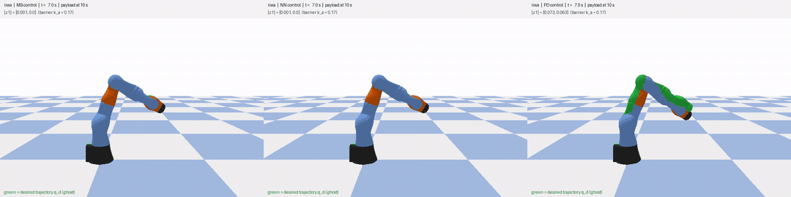

# Adaptive NN Control of an Uncertain Robot With Full-State Constraints — reproduction

Python reproduction of W. He, Y. Chen, Z. Yin, *IEEE Trans. Cybernetics* 46(3):620–629, 2016
(barrier-Lyapunov backstepping + RBF neural network for a 2-link arm).

```bash
python run_simulations.py                      # MB, NN, PD on the paper's setup (30 s, ~1 min)
python run_simulations.py --q0 0.1 2.1 --dt 2e-5 --out results_offset   # non-zero initial error (needs small dt)
python run_simulations.py --cases NN --no-disturbance
python -m pytest -q tests
python demos/run_demo.py --robot iiwa --controller NN --payload 2 --gui --realtime   # PyBullet demo
```

Outputs per controller in `results/<MB|NN|PD>/` (x1 vs x_d, x2 vs α, z1, z2, τ, NN weight
norms), `results/comparison_errors.png`, raw logs (`*_log.npz`) and `summary.json`.



*KUKA LBR iiwa in PyBullet. Left to right: MB, NN, PD. A 2 kg payload is added at t = 10 s (end effector turns red). Green ghost = desired trajectory.*

## Layout

| file | content | paper |
|---|---|---|
| `annc/params.py` | Table I, constraints k_c1, k_c2, X0, Y0, all gains | §IV |
| `annc/robot.py` | M, C, G, J, kinetic/potential energy | (31)–(37) |
| `annc/signals.py` | q_d(t), external force f(t) with clipped Gaussian d(t) | §IV |
| `annc/rbf.py` | Gaussian RBF, 256 centres on {−1,1}^8 | §IV-A/B |
| `annc/controllers.py` | MB control, adaptive NN control + law, PD | (8)–(9), (14), (15), (17), (19) |
| `annc/simulate.py` | fixed-step RK4, algebraic-loop solve | — |
| `demos/bullet_arm.py` | PyBullet plant (torque control, locked joints, payload, ghost, video) and nominal model | — |
| `demos/run_demo.py` | PyBullet demos: paper's arm URDF and KUKA iiwa | — |
| `demos/planar_2link.urdf` | Table I arm as a URDF | Fig. 1 |
| `tests/test_annc.py` | Lagrangian consistency, Ṁ−2C skew, pinv, α̇, loop solve, closed loop | — |

## Equations implemented

* z1 = x1 − x_d, α = ẋ_d − A with A_i = (k_ai² − z1i²) k1i z1i, z2 = x2 − α.
  α̇ is computed analytically: α̇ = ẍ_d − k1 (k_a² − 3 z1²)(x2 − ẋ_d).
* (z2ᵀ)⁺ = z2/‖z2‖² (0 when z2 = 0), eq. (14).
* **MB (15)**: τ = Jᵀf + C x2 + G + M α̇ − K2 z2 − (z2ᵀ)⁺ Σ z1i z2i/(k_ai²−z1i²) − (z2ᵀ)⁺ Σ z2i(a_i−α̇_i)/(k_bi²−z2i²).
* **NN (19)**: τ = −(z2ᵀ)⁺ Σ[ z2i(a_i−α̇_i)/(k_bi²−z2i²) + k1i z1i²/(k_ai²−z1i²) + k2i z2i²/(k_bi²−z2i²) + z1i z2i/(k_ai²−z1i²) ] − Ŵᵀ S(Z) − K3 z2,
  with Z = [x1, x2, α, α̇] ∈ ℝ⁸ and **(17)** Ŵ̇_i = Γ_i [S(Z) z2i − σ_i |z2i| Ŵ_i].
* **PD**: τ = −Kp z1 − Kd ż1.

## Implementation decisions / gaps in the paper

1. **Acceleration algebraic loop.** (15) and (19) use the joint acceleration a = ẋ2, which itself
   depends on τ. Each controller returns τ = τ0 + B a (B = −(z2ᵀ)⁺ wᵀ, w_i = z2i/(k_bi²−z2i²))
   and the simulator solves (I − B M⁻¹) τ = τ0 − B M⁻¹ h exactly. This models an ideal,
   instantaneous acceleration measurement. The controller still uses no model knowledge
   (the solve uses the *plant*). A one-sample-delayed acceleration estimate is **not**
   viable: the loop gain ~ λ(M⁻¹)/k_b² ≫ 1 makes it diverge.
2. **Not given in the paper (assumed):** l_c1 = l1/2, l_c2 = l2/2 (gives the paper's PD
   gravity offset, Fig. 15); g = 9.81; RBF width b = 2 in exp(−‖Z−c‖²/2b²); noise d(t) held
   for 10 ms and clipped to the reported [−0.783, 0.818]; Ŵ(0) = 0.
3. **Typo:** G11 is printed with m1·l_c2; the potential-energy gradient (and a unit test) gives m1·l_c1.
4. Initial conditions: §IV-A/B use q(0) = [0, 2], q̇(0) = [0.5, 0] (eq. 38's zero ICs are overridden).
   These match q_d(0), q̇_d(0), so z1(0) = z2(0) = 0.
5. The paper's derivation drops the ½ z2ᵀṀz2 term in V̇2. We implement the laws as published.
6. Integration: RK4, dt = 5e-4 s (agrees with dt = 1e-4 to <1e-3 rad; see tests).

## Results (paper setup, `results/summary.json`)

| | max abs(z1) [rad] | max abs(z2) | abs(z1)<k_a, abs(z2)<k_b | abs(q)≤k_c1, abs(q̇)≤k_c2 | max abs(τ) [Nm] |
|---|---|---|---|---|---|
| MB | 0, 0 | 0, 0 | yes | yes | 7.1, 1.8 |
| NN | 0.0039, 0.0008 | 0.019, 0.005 | yes | yes | 7.1, 1.9 |
| PD | 0.26, 0.44 | 1.86, 1.29 | **no** | **no** | 10.6, 2.2 |

These match the paper's qualitative conclusions. MB and NN track inside the barrier,
and PD violates the constraints. MB is exact here because the model is exact and the
initial error is zero. The paper's Figs. 3/5 show small non-zero MB errors, presumably
from its discrete Simulink implementation. The paper's NN torques (Fig. 13: about −100 / +180 Nm
steady) are not reproduced. Our NN torques converge to the physically required
gravity and disturbance compensation (a few Nm).

### Observations beyond the paper (`--q0 0.1 2.1`)

* Convergence of z1 is slow on joints with small k1. In (9) the rate is k1·k_a², so it is
  ≈0.14 s⁻¹ for MB joint 2 (k1 = 5) and ≈0.03 s⁻¹ for NN joint 2 (k1 = 1).
* (z2ᵀ)⁺ is discontinuous at z2 = 0, so the NN control chatters whenever z2 crosses zero (spikes in z2, τ).
* With this initial error the closed loop is very stiff, and (z2ᵀ)⁺ switches whenever z2 crosses zero, so the fixed step must be small. At dt = 5e-4 the NN run briefly exceeds the z2 barrier (abs(z22) ≈ 0.24 > k_b = 0.18 at t ≈ 0.2 s), and at dt = 1e-4 it diverges. At dt = 2e-5 the barrier holds (max abs(z22) = 0.169). The breach is numerical, not a property of the control law. Use `--dt 2e-5` for non-zero initial errors. dt = 5e-4 is fine for the paper's zero-error initial conditions.

## PyBullet demos (`demos/`)

```bash
python demos/run_demo.py --robot planar --controller NN --gui --realtime
python demos/run_demo.py --robot iiwa --controller NN --payload 2 --gui --realtime
python demos/run_demo.py --robot iiwa --controller all --payload 2 --record demos/media/iiwa.mp4
```

Options: `--payload KG --payload-time S`, `--q0-offset dq1 dq2`, `--no-disturbance`, `--tf`, `--dt`, `--record x.mp4|x.gif`.
Plots and `summary.json` go to `demos/results/<robot>/`, videos to `demos/media/`.

* **planar**: the paper's arm built as a URDF from Table I. PyBullet's own rigid-body model of
  it matches eqs. (34)–(37) to 1e-15 (`tests/test_pybullet.py`), so this independently
  confirms the paper's dynamics.
* **iiwa**: KUKA LBR iiwa 14 from `pybullet_data`. Joints 2 and 4 (shoulder/elbow pitch, motion
  in the x–z plane) run the controllers. The other five joints are locked by stiff position
  servos. The URDF's joint damping (0.5 N·m·s/rad) is real unmodelled friction for MB. The paper's
  f(t) acts on the end effector. The reference is q_d = [0.5 + 0.4 sin(0.5t), −1 + 0.8 cos(0.5t)].
  The paper's error bounds are kept (k_a = 0.17, k_b = 0.18). Gains are larger than Table I's
  for this much heavier arm (see `ROBOTS` in `run_demo.py`).
* **MB** uses a *separate* PyBullet client as its model, so it never learns about the payload.
  **NN** has no model at all and starts from Ŵ = 0.

Results, 30 s with disturbance (`demos/results/*/summary.json`):

| robot | controller | max abs(z1) [rad] | RMS z1 after 5 s | barrier respected |
|---|---|---|---|---|
| planar | MB | 0.0001, 0.0001 | 0.0000, 0.0001 | yes |
| planar | NN | 0.0046, 0.0010 | 0.0010, 0.0004 | yes |
| planar | PD | 0.26, 0.44 | 0.13, 0.21 | **no** |
| iiwa, +2 kg at 10 s | MB | 0.153, 0.092 | 0.113, 0.043 | yes (0.153 vs k_a = 0.17) |
| iiwa, +2 kg at 10 s | NN | 0.0051, 0.0018 | 0.0010, 0.0003 | yes |
| iiwa, +2 kg at 10 s | PD | 0.158, 0.121 | 0.112, 0.093 | **no** (z2) |

This is the paper's claim on a real robot model. The NN controller learns the iiwa's unknown
dynamics online and absorbs a 2 kg payload step with no visible effect. The model-based
controller's error grows about 30× when its model becomes wrong, and it ends up close to the barrier.

### Simulation pitfalls found (and fixed) in PyBullet

The controller's (z2ᵀ)⁺ wᵀ a term has a gain of about M⁻¹/k_b². Any mismatch between the
"measured" acceleration and the real one is amplified until the barrier breaks. Two PyBullet
behaviours caused exactly that, and `tests/test_pybullet.py` guards against both:

1. `calculateInverseDynamics` ignores URDF joint damping, but `stepSimulation` applies it. The
   plant model now adds D·q̇.
2. `calculateMassMatrix` / `calculateInverseDynamics` do not see `changeDynamics(mass=…)`. For links
   without a collision shape, that call also silently resets the inertia to about 0 unless
   `localInertiaDiagonal` is passed. The plant now rebuilds its truth model from a modified URDF and
   keeps the inertia.

Also note: load URDFs with `URDF_USE_INERTIA_FROM_FILE`. Without it PyBullet recomputes inertia from
the collision shapes. And `calculateJacobian`'s `localPosition` is relative to the URDF link frame.
